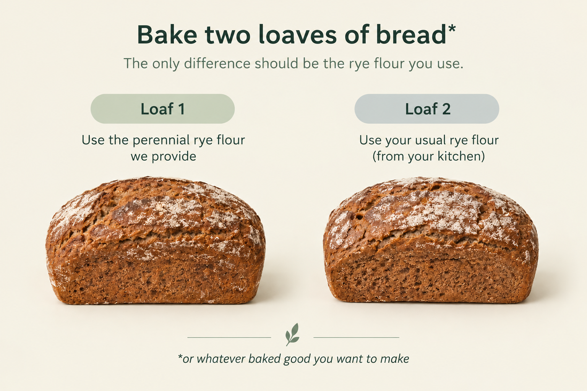

# Informationsark

Hvis du modtager dette informationsark, betyder det, at du har vist interesse for at deltage i en hjemmebagningsundersøgelse med en ny flerårig rugsort. **Tusind tak!** Formålet med dette ark er at give dig mere information om den nye sort, så du kan beslutte, om du har lyst til at deltage. Da du viste interesse, accepterede du vores datapolitik, som du kan læse igen her: [GoodGrain General Data Protection Regulation (PDF)](documents/GDPdocument.pdf){target="_blank"}.

{fig-cap="Figur 1." width="85%"}

# Hvad sker der nu?

1.  Læs dette informationsark på engelsk eller dansk eller se [informationsvideoen](https://agro-nichols-goodgrain.share.connect.posit.cloud/video.html) (på engelsk).

2.  Når du har læst informationsarket eller set videoen, kan du *udfylde det tilmeldingsskema*, som du har modtaget via e-mail, hvis du beslutter dig for at deltage i vores forskning.

# Om GoodGrain projektet

Alle de afgrøder, der almindeligvis bruges til at bage brød, er etårige (for eksempel hvede, havre og rug). Det betyder, at de sås, giver én kornhøst om året og derefter skal sås igen. Hvis en afgrøde var flerårig og kunne leve i flere år, ville den kunne give to eller tre kornhøster efter blot én såning. Det ville spare landmanden for meget arbejde (og mange ture med traktoren).

Desuden ville en flerårig kornafgrøde potentielt kunne udvikle et større rodsystem, hvis den fik lov til at blive på marken i mange år uden at jorden blev forstyrret. Det ville gøre planten bedre i stand til at optage næringsstoffer og vand, samtidig med at den kunne lagre mere kulstof og understøtte livet i jorden.

Du kan læse mere om idéen bag flerårige kornafgrøder og deres historie i afsnittet ***Til dig, der er nysgerrig*** nedenfor.

For nyligt er nogle få sorter af flerårige kornarter blevet til gængelige, herunder en flerårig rugsort. Denne nye sort afprøves i markforsøg for at undersøge, hvordan den vokser under danske forhold, og hvordan den påvirker miljøet sammenlignet med en etårig rugsort.

**GoodGrain**-projektet bygger videre på denne viden ved specifikt at undersøge kornegenskaberne hos den nye flerårige rugsort. En af disse egenskaber er bagekvaliteten. Det er vigtigt for **GoodGrain**-projektet at inddrage lokalsamfundet i dette arbejde.

Du kan læse lidt mere om projektet [her](https://projects.au.dk/plant2food/funded-projects/goodgrain).

# Hvad forventes der af mig som deltager i GoodGrains hjemmebagningsundersøgelse?

De vigtigste formål med denne hjemmebagningsundersøgelse er at:

1.  Begynde at undersøge, hvordan denne flerårige rug bedst kan anvendes af hjemmebagere.

2.  Identificere potentielle områder, hvor den flerårige rugs bageegenskaber kræver yderligere forskning inden for dyrkning eller forædling.

3.  Undersøge, hvordan folk oplever det at bage med flerårig rug.

Som borgerforsker vil du modtage enten 400 eller 800 gram mel, afhængigt af dit behov. Vi håber, at du vil gennemføre et bageforsøg, hvor du afprøver to versioner side om side: én med den flerårige rug, vi leverer, og én med den rug du normalt bruger.

Du er også velkommen til at blande rugen med andre kornsorter, hvis det er sådan du plejer at bage. Hvis du bruger en rugsurdej kan du prøve at anvende den nye rug i den. Hvis du normalt bager knækbrød, laver pizzadej eller bager småkager er det også helt fint!

Vi vil gerne give dig frihed til at bruge melet til at bage lige det du har lyst til og som gør dig glad. Vi beder dig dog om at tilgå forsøget så systematisk som muligt og bage det du vælger, både med den flerårige rug og med den rug du normalt bruger.

Du skal selv købe eventuelle ekstra ingredienser, som du har brug for til bagningen.

Du vil få udleveret et ark, der hjælper dig med at tage noter under bagningen. Noterne kan du efterfølgende bruge til at udfylde et opfølgende spørgeskema. Spørgeskemaet består af tre overordnede dele:

1.  Enkle demografiske oplysninger om alle der deltog i bagningen (vi ved at nogle bager alene, mens andre bager sammen med deres børn, forældre eller partner).

2.  En beskrivelse af det du har bagt.

3.  Spørgsmål om hvordan det bagværk der er lavet med den flerårige rug adskiller sig fra det der er lavet med den etårige rug.

Vi forventer at det tager mellem 15 og 30 minutter at udfylde det opfølgende spørgeskema.

**Afhængigt af hvad du vælger at bage, kan hele projektet tage en halv til en hel dag at gennemføre!** Vi er klar over, at det kræver en del tid, og når du har udfyldt det opfølgende spørgeskema, vil du modtage en lille tak-for-hjælpen-gave 🎁.

# Frivillige aktiviteter

I sommeren 2027 afholder **GoodGrain**-projektet et arrangement, hvor du kan se den flerårige rugsort vokse på en forsøgsmark. I efteråret 2027 afholdes et offentligt symposium i København, hvor den nyeste viden om flerårig rug deles med alle led i værdikæden – forskere, forædlere, landmænd, møllere, bagere og brødspisere.

Arrangementerne er gratis og åbne for offentligheden. Du er meget velkommen til at deltage, men det er helt *frivilligt*.

# Svar på nogle almindelige spørgsmål

## Er det sikkert at spise?

Ja. Kornet, som melet, du modtager, er fremstillet af, er blevet analyseret af et uafhængigt laboratorium for at sikre, at det er sikkert at spise, og for at måle proteinindholdet. Du kan se analyseresultaterne her: GoodGrain – laboratorieresultater (PDF).

## Er den flerårige rugsort genmodificeret ved hjælp af nye forædlingsteknologier?

Nej. Sorten er udviklet ved hjælp af traditionelle forædlingsmetoder, hvor planter krydses manuelt, og der udvælges planter på baggrund af deres fysiske egenskaber. Du kan læse mere om sorten i [denne videnskabelige artikel fra 1986](https://onlinelibrary.wiley.com/doi/abs/10.1111/j.1439-037X.1986.tb00077.x).

## Er dette korn økologisk?

Nej. Aarhus Universitet har ikke økologisk certificerede arealer, da en sådan certificering ville medføre ekstra omkostninger og administrativt arbejde. Kornet er dog dyrket uden brug af pesticider.

## Kan jeg købe dette mel et sted?

Mel fra denne flerårige rugsort er endnu ikke tilgængeligt i handelen. Projektet er med til at skabe grundlaget for en mulig fremtidig kommerciel lancering, og vi sætter stor pris på din hjælp!

# Til dig, der er nysgerrig

Overordnet set kan planter groft opdeles i to kategorier: flerårige og etårige. Flerårige planter lever i mere end ét år, mens etårige planter gennemfører deres livscyklus på ét år.

I naturen er flerårige planter meget almindelige. Tænk for eksempel på en park i dit nabolag eller en skov: Her finder du træer, buske og måske græs. Det er alt sammen flerårige planter. Til gengæld er mange af de planter, du dyrker i køkkenhaven etårige, hvilket betyder at du skal så eller plante dem igen hvert år (for eksempel radiser, salat og agurker).

Dette generelle mønster med »flerårige planter i naturen og etårige planter i landbruget« ses faktisk på globalt plan. Selvom vi har mange fantastiske flerårige afgrøder, såsom æbler, avocadoer og kaffe, er de afgrøder vi bruger mest, og som dyrkes på de største arealer, etårige. Det kan du se på figuren nedenfor.

![I naturen er kun 6 % af plantearterne etårige. De tidlige landbrugere ser ud til at have foretrukket etårige planter, da 42 % af de planter, vi på en eller anden måde har domesticeret, er etårige. Selvom mindre end halvdelen af de planter vi har domesticeret er etårige, dyrkes **størstedelen** af vores landbrugsarealer med etårige afgrøder. Det skyldes at størstedelen af de kalorier mennesker indtager, stammer fra etårige afgrøder som majs, ris, kartofler og hvede. De afgrøder vi almindeligvis bruger til at bage brød i Danmark (hvede, havre og rug) er alle etårige. Figuren er udarbejdet af Virginia Anne Nichols.](images/figure-3.png){fig-cap="Figur 2."}

Er etårige planter bedre end flerårige planter til fødevareproduktion? Valgte mennesker *bevidst* at domesticere etårige afgrøder, eller var det blot et tilfælde? Disse spørgsmål diskuteres stadig blandt forskere. Uanset hvordan vi er nået hertil, er det dog tydeligt at det ville være godt for miljøet at integrere flere flerårige planter i vores landbrugsarealer.

Flerårige planter har generelt en række miljømæssige fordele. Deres omfattende rodsystemer gør dem i stand til at udnytte ressourcer som vand og kvælstof mere effektivt. De bidrager også til at lagre kulstof i jorden og holder jorden dækket hele året. At udvikle flerårige udgaver af vores vigtigste afgrøder, såsom den flerårige rug, der anvendes i dette projekt, er én måde at få flere flerårige planter ind på vores landbrugsarealer.

Mennesker har længe været opmærksomme på de potentielle fordele ved flerårige kornsorter. Allerede siden 1930'erne har man forsøgt at forædle flerårig hvede i Sovjetunionen! Tidligere har det været en meget vanskelig opgave, især fordi forskerne havde begrænsede muligheder for at undersøge hvad der foregik i planternes genetik. Trods disse udfordringer havde enkelte laboratorier held med arbejdet og opnåede lovende resultater, blandt andet ved Hohenheim Universitet i Tyskland.

Her lykkedes det i 1960'erne for Dr. Reimann-Philips og hendes team at krydse en etårig rugsort med en ældre, flerårig rugforfader. Teamet afprøvede resultaterne og foretog yderligere udvælgelse af planter med ønskede egenskaber. Den resulterende afgrøde var flerårig (se figuren nedenfor) og i 1990'erne blev den indsendt til vurdering med henblik på at blive godkendt som en sort i Tyskland.

{fig-cap="Figur 3."}

Den tyske regering afviste ansøgningen af en række komplicerede årsager, og sorten blev aldrig officielt lanceret. Forædlerne bevarede nogle forsøgsparceller som et personligt passionprojekt. Noget af materialet blev senere lanceret som foderafgrøde til vildt, men den flerårige rug har ikke fået den store opmærksomhed i de seneste 30 år.

I 2023 delte Dr. Thomas Miedaner, som overtog Hohenheim Universitets rugforædlingsprogram efter Dr. Reimann-Philips' død, frø fra denne afgrøde med flere forskere på Aarhus Universitet. Vi mener, at flerårig rug har et stort potentiale i Danmark!

I 2025 afprøvede vi den flerårige rug side om side med en højtydende, etårig rugsort. Vi var meget imponerede over, at den flerårige rug gav halvdelen af kornudbyttet fra den moderne, etårige sort, især når man tager i betragtning, at den flerårige rug stammer fra krydsninger med sorter fra 1960'erne! Den flerårige rug gav igen korn i 2026, men vi har brug for mere forskning for at finde frem til den optimale måde at dyrke og pleje afgrøden på.

Vi mener at denne sort fortjener at blive videreudviklet, og denne bevilling er en del af det arbejde. Et af målene med projektet er at undersøge, hvordan den nye flerårige rug fungerer i private køkkener, og hvordan folk oplever det at spise korn fra en flerårig afgrøde.

# Finansiering og projektpartnere

Projektet er en del af et forskningsprojekt under Novo Nordisk Fondens Plant2Food-program (bevilling nr. NNF22SA0081019). Projektet gennemføres ved [Institut for Agroøkologi](https://agro.au.dk/en/) og [Institut for Fødevarer](https://food.au.dk/) på Aarhus Universitet i Danmark i samarbejde med [Wageningen University & Research](https://www.wur.nl/en/persons/lr-laura-righetti) i Nederlandene og [Meyers](https://meyers.dk/), en fremtrædende dansk fødevarevirksomhed. Som nævnt ovenfor kan du læse mere om GoodGrain-projektet [her](https://projects.au.dk/plant2food/funded-projects/goodgrain).
